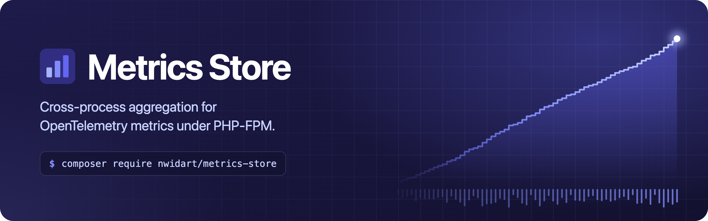

[](https://github.com/nWidart/metrics-store/actions/workflows/ci.yml)
[](https://packagist.org/packages/nwidart/metrics-store)
[](LICENSE.md)

Cross-process aggregation for OpenTelemetry metrics in shared-nothing PHP runtimes such as PHP-FPM.

Each request records through the OpenTelemetry SDK as usual. After the response, it merges its metrics into Redis in one round trip. An export process reads the cumulative values and sends them with the standard OpenTelemetry exporters, or serves them to Prometheus.

For Laravel, use [`nwidart/laravel-metrics`](https://github.com/nWidart/laravel-metrics). It wires all of this for you.

- [Why](#why)
- [Installation](#installation)
- [Usage](#usage)
- [Stores](#stores)
- [Performance and overhead](#performance-and-overhead)
- [Operations and limits](#operations-and-limits)
- [Development](#development)

## Why

The OpenTelemetry PHP SDK keeps metrics in process memory. Under PHP-FPM, every request starts with a new `MeterProvider`, so cumulative counters reset on each request. Delta temporality avoids the reset, but Prometheus cannot ingest delta, and the Collector's `deltatocumulative` processor drops deltas that arrive out of order.

This package adds the one missing part: aggregation across processes. OpenTelemetry stays at both ends.

```
FPM request (any worker, any host)
  app code ──► OTel Meter API ──► OTel SDK (delta, this request only)
                                    │ after the response is sent
                                    ▼
                           StoreExporter: one EVALSHA
                                    ▼
                           Redis: cumulative series
                                    ▲
Export process                      │ read only
  scheduled push ───────────────────┤──► OTel OTLP exporter (cumulative)
  GET /metrics ─────────────────────┘──► Prometheus text format
```

Read the [design](docs/design.md) for the decisions and the alternatives.

## Installation

```bash
composer require nwidart/metrics-store
```

Requirements:

- PHP 8.2 or later
- For `RedisStore`: Redis, with `ext-redis` (phpredis) or `predis/predis`

## Usage

### Record in each request

Give the meter provider a `StoreExporter`. Shut the provider down after the response is sent: the shutdown merges the request's metrics into the store.

```php
use Nwidart\MetricsStore\Redis\PhpRedisClient;
use Nwidart\MetricsStore\RedisStore;
use Nwidart\MetricsStore\StoreExporter;
use OpenTelemetry\SDK\Metrics\MeterProviderBuilder;
use OpenTelemetry\SDK\Metrics\MetricReader\ExportingReader;

$redis = new Redis();
$redis->pconnect('127.0.0.1', 6379);
$store = new RedisStore(new PhpRedisClient($redis));

$provider = (new MeterProviderBuilder())
    ->addReader(new ExportingReader(new StoreExporter($store)))
    ->build();

$meter = $provider->getMeter('shop');
$meter->createCounter('app.orders.placed', '{order}')->add(1, ['channel' => 'web']);
$meter->createHistogram('app.checkout.duration', 's', null, ['ExplicitBucketBoundaries' => [0.1, 0.5, 1, 5]])
    ->record(0.42);

// Send the response first, then merge.
fastcgi_finish_request();
$provider->shutdown();
```

With predis, use `new PredisClient(new Predis\Client(...))` instead of `PhpRedisClient`.

`StoreExporter` asks the SDK for delta temporality, so each merge adds only what this request recorded. It never throws: on a store failure, it logs a warning through the OpenTelemetry logger and the request goes on.

In a long-running process (queue worker, Octane, a daemon), keep one provider and call `$provider->forceFlush()` after each unit of work. Each flush merges what was recorded since the previous one.

Observable instruments (asynchronous counters and gauges) are not merged from requests. Their callbacks report a current value, so merging them would add the full value on every request. Register them in the export process instead.

### Export over OTLP

Read the store in one process on a schedule, for example every minute, and send it with the OpenTelemetry OTLP exporter (`composer require open-telemetry/exporter-otlp`):

```php
use OpenTelemetry\Contrib\Otlp\ContentTypes;
use OpenTelemetry\Contrib\Otlp\MetricExporter;
use OpenTelemetry\Contrib\Otlp\OtlpHttpTransportFactory;
use OpenTelemetry\SDK\Common\Attribute\Attributes;
use OpenTelemetry\SDK\Resource\ResourceInfo;
use OpenTelemetry\SDK\Resource\ResourceInfoFactory;

$resource = ResourceInfoFactory::emptyResource()
    ->merge(ResourceInfo::create(Attributes::create(['service.name' => 'shop'])));

$exporter = new MetricExporter(
    (new OtlpHttpTransportFactory())->create('http://localhost:4318/v1/metrics', ContentTypes::PROTOBUF),
);
$exporter->export($store->collect($resource));
$exporter->shutdown();
```

The store does not keep the resource. The export process gives it to `collect()`.

`collect()` returns cumulative values, so a push is idempotent: a lost or repeated push does no harm, and the next push repairs it.

### Serve Prometheus

`PrometheusTextFormat` renders what `collect()` returns in the Prometheus text format, with the names of the OpenTelemetry Prometheus compatibility specification (`app.checkout.duration` in `s` becomes `app_checkout_duration_seconds`, a monotonic sum ends in `_total`):

```php
use Nwidart\MetricsStore\Prometheus\PrometheusTextFormat;
use OpenTelemetry\SDK\Resource\ResourceInfoFactory;

$text = (new PrometheusTextFormat())->render(
    $store->collect(ResourceInfoFactory::emptyResource()),
    ['service' => 'shop'], // optional labels added to every sample
);

header('Content-Type: '.PrometheusTextFormat::CONTENT_TYPE);
echo $text;
```

## Stores

Every store implements `MetricStore` (`merge()`, `collect()`, `clear()`) and follows the same rules:

- A sum adds the deltas.
- A histogram adds its bucket counts and its sum. Min and max are not kept.
- A gauge keeps the value with the newest timestamp.
- Each series keeps its start timestamp. An empty store gives new start timestamps, which backends read as a counter reset.
- Each metric keeps at most `cardinalityLimit` series (2000 by default, as in the OpenTelemetry specification). Extra attribute sets go to one series with the attribute `otel.metric.overflow = true`.

A metric is identified by its instrumentation scope, name, unit, kind and histogram bucket boundaries. Keep the boundaries of a histogram fixed: other boundaries make another metric.

| Store | Scope | Use |
|---|---|---|
| `RedisStore` | Every process and host that uses the same Redis | Production |
| `InMemoryStore` | One process | Tests, or as the engine of another store |

`RedisStore` takes a key prefix (`{metrics}:` by default) and a cardinality limit:

```php
new RedisStore($client, prefix: '{metrics}:', cardinalityLimit: 2000);
```

A key prefix set on the Redis client (phpredis `OPT_PREFIX`, the predis `prefix` option) is kept: every key stays under it.

`InMemoryStore::state()` returns its data as an array, and the constructor takes it back. Another store can persist it between processes. laravel-metrics uses this to keep a development store in one Laravel cache entry.

## Performance and overhead

A request pays for three things: booting the SDK, recording, and one merge into Redis. The merge runs after the response is sent.

### Why it is cheap

- **Recording does no I/O.** The OpenTelemetry SDK aggregates in process memory during the request.
- **One round trip per request.** The merge is one `EVALSHA` call to a cached Lua script, whatever the number of metrics. `EVAL` runs only when Redis does not have the script yet.
- **Off the response path.** With `fastcgi_finish_request()` before the shutdown, the client does not wait for the merge.
- **Small script work.** The script reads a flat argument list, with no JSON decoding in Lua. It writes a series' attributes, start timestamp and metric description only the first time it sees the series. It sends only non-empty histogram buckets, and derives the histogram count from them.
- **Bounded reads.** `collect()` reads one metric at a time, at most 100 series per Redis call, so a large store never blocks Redis for long. `clear()` deletes one metric per call.
- **Bounded memory.** The cardinality limit caps the series per metric. Redis holds one hash per series, one set per metric, and one hash of metric descriptions.
- **Failure isolation.** A Redis failure costs a logged warning, never a failed request.

### Measured cost

Measured on PHP 8.4 FPM (opcache on, 8 static workers, phpredis with `pconnect`) and a local Redis 7.4, in Docker on an Apple M3 Max with 4 CPUs shared by everything. Each request recorded 8 values into 1 HTTP histogram, 5 database histograms, 1 counter and 1 up-down counter. Absolute numbers depend on the machine. Read them as orders of magnitude.

| Step | Cost per request |
|---|---|
| Boot the SDK (provider, reader, 4 instruments) | about 75 µs |
| Record 8 values | about 30 µs |
| Merge, PHP worker time (after the response) | 117–132 µs with idle workers, 229–251 µs with all workers busy |
| Merge, Redis CPU | 23–26 µs |
| Merge payload | about 1.5 KB |

Effect on response latency, p50 compared with no metrics, latency measured by `wrk` through nginx:

- Boot and record: +0.08 to +0.20 ms, at 1 or 8 concurrent connections.
- With the merge, 1 connection: at most +0.14 ms.
- With the merge, 8 connections on 8 workers (saturated): +0.56 to +0.58 ms.

While workers have spare capacity, the merge barely touches response latency. Under saturation it acts like extra request time, because a worker that is still merging cannot take the next request.

Redis CPU per merge grows with the number of data points. A heavier workload of 12 data points (30 queries, cache counters and an HTTP histogram) costs 60–72 µs of Redis CPU per merge. One Redis instance therefore caps out at about 40,000 merging requests per second for the light workload, and about 15,000 for the heavy one, summed over all hosts.

Correctness was checked under the same load: 20,000 requests across 8 workers gave exactly 20,000 in Redis and in Prometheus, for every counter and every histogram.

### Scaling to hundreds of metrics

[`benchmarks/scale.php`](benchmarks/scale.php) measures how the store grows with the number of metrics and series. It ran in the same Docker setup, on PHP 8.4 CLI with opcache and phpredis, on the Docker network of Redis 7.4.

**Merge.** One simulated request creates M instruments, records one value into each, with one attribute set, and flushes through `StoreExporter`. Times are averages per request. "Mixed" is half counters, a quarter histograms (14 buckets) and a quarter gauges. "Redis CPU, first merge" is the merge into an empty store, where every series is new.

| Kind | Metrics | Record | Flush | Redis CPU | Redis CPU, first merge | Payload |
|---|---:|---:|---:|---:|---:|---:|
| counter | 10 | 88 µs | 133 µs | 29 µs | 151 µs | 2.8 KB |
| counter | 100 | 0.76 ms | 0.84 ms | 0.22 ms | 0.55 ms | 28 KB |
| counter | 250 | 2.0 ms | 1.9 ms | 0.55 ms | 1.0 ms | 70 KB |
| counter | 500 | 3.6 ms | 3.2 ms | 1.0 ms | 2.1 ms | 140 KB |
| counter | 1,000 | 7.7 ms | 7.9 ms | 2.2 ms | 4.7 ms | 279 KB |
| counter | 2,000 | 14.9 ms | 12.8 ms | 4.0 ms | 7.8 ms | 560 KB |
| histogram | 10 | 107 µs | 188 µs | 47 µs | 92 µs | 3.5 KB |
| histogram | 100 | 1.0 ms | 1.4 ms | 0.44 ms | 0.53 ms | 35 KB |
| histogram | 250 | 2.8 ms | 3.7 ms | 1.1 ms | 1.4 ms | 88 KB |
| histogram | 500 | 5.3 ms | 6.8 ms | 2.3 ms | 2.6 ms | 177 KB |
| histogram | 1,000 | 9.4 ms | 12.4 ms | 4.1 ms | 5.7 ms | 354 KB |
| histogram | 2,000 | 21.7 ms | 29.2 ms | 8.7 ms | 10.2 ms | 709 KB |
| mixed | 10 | 91 µs | 157 µs | 33 µs | 94 µs | 2.9 KB |
| mixed | 100 | 0.79 ms | 1.0 ms | 0.28 ms | 0.50 ms | 30 KB |
| mixed | 250 | 2.3 ms | 2.6 ms | 0.76 ms | 1.4 ms | 75 KB |
| mixed | 500 | 4.5 ms | 4.6 ms | 1.5 ms | 2.5 ms | 149 KB |
| mixed | 1,000 | 9.3 ms | 10.5 ms | 2.9 ms | 3.9 ms | 299 KB |
| mixed | 2,000 | 19.5 ms | 19.4 ms | 5.7 ms | 8.4 ms | 598 KB |

- The cost is linear in the number of data points. Redis CPU is about 2 µs per counter point and 4 µs per histogram point.
- Most of the PHP time is the OpenTelemetry SDK. For 1,000 counters, creating the instruments takes 5.3 ms, recording 1.8 ms, and the SDK collection 2.8 ms. The store's own work, building the arguments and the round trip, takes 4.8 ms.
- The payload is about 290 bytes per counter and 360 bytes per histogram. Every merge sends the metric description and the attributes, because the request does not know whether the series exists yet.
- Redis runs one script at a time, so the merge's Redis CPU caps the request rate of one Redis instance. Summed over all hosts, that is about 2,000 to 4,500 merging requests per second at 100 metrics per request, and about 250 to 450 at 1,000, histograms being the expensive end.

**Collect.** The store holds M metrics, mixed kinds, with S series each. "Collect" is `collect()`, "render" is `PrometheusTextFormat::render()`, as for one Prometheus scrape.

| Metrics × series | Series | Collect | Render | Redis calls | Longest call | Redis CPU | Text | Redis memory per series |
|---|---:|---:|---:|---:|---:|---:|---:|---:|
| 100 × 1 | 100 | 3.4 ms | 0.6 ms | 101 | 0.17 ms | 0.6 ms | 52 KB | 1,875 B |
| 100 × 10 | 1,000 | 8.6 ms | 4.5 ms | 101 | 0.21 ms | 2.6 ms | 489 KB | 767 B |
| 100 × 100 | 10,000 | 66 ms | 52 ms | 101 | 0.67 ms | 23 ms | 4.8 MB | 533 B |
| 500 × 10 | 5,000 | 53 ms | 26 ms | 501 | 0.91 ms | 15 ms | 2.4 MB | 590 B |
| 1,000 × 1 | 1,000 | 41 ms | 6.5 ms | 1,001 | 1.2 ms | 7.1 ms | 525 KB | 1,642 B |
| 1,000 × 10 | 10,000 | 98 ms | 52 ms | 1,001 | 1.3 ms | 28 ms | 4.8 MB | 616 B |
| 1,000 × 100 | 100,000 | 647 ms | 533 ms | 1,001 | 1.3 ms | 249 ms | 48 MB | 312 B |

- A scrape of 100,000 series takes about 1.2 s and never blocks Redis for more than about 1.3 ms at a time.
- Collection makes one call for the metric descriptions, then one call per metric and per 100 series.
- Memory per series falls as series grow, because the metric description and the index set are shared. 100,000 series take about 30 MB.

Below a few hundred data points per request, the merge stays well under a millisecond of Redis time. Past that, Redis throughput is the limit, not latency: plan the Redis capacity from the data points per request times the request rate.

### Keep the overhead low

- **Use an optimized Composer autoloader in production**: `composer install --optimize-autoloader` or `composer dump-autoload -o`. Without it, booting the SDK takes about 1 ms instead of 75 µs.
- Preload the OpenTelemetry classes with opcache to cut the boot further, to about 40 µs.
- Call `fastcgi_finish_request()` before the provider shutdown.
- Use a persistent Redis connection (`pconnect`, or the predis `persistent` option). A new connection per request adds a handshake to every merge. Keep Redis close to the application: a remote Redis adds a network round trip.
- Keep attribute cardinality low. Each new series costs a few more Redis calls on its first merge, and memory for as long as the store lives.
- Prefer a glibc Redis build to an Alpine (musl) build. Float parsing is slower on musl, and float-heavy merges run about 1.5× faster on glibc.

## Operations and limits

- **Use one Redis without eviction.** Set `maxmemory-policy noeviction`, or give the store its own Redis. An evicted key loses data silently.
- **Run one exporter.** Two pushers with clocks out of step can send an older timestamp after a newer one, and Prometheus's OTLP receiver rejects out-of-order samples.
- **Push more often than the backend forgets.** The Collector's Prometheus exporter drops series after `metric_expiration` (5 minutes by default) without a push.
- **A cleared or restarted store resets every series.** Backends see a counter reset, which rate functions handle. Series that get no new traffic keep their old value in the Collector until `metric_expiration`.
- **Redis Cluster is not tested.** All keys share the hash tag of the prefix, so they live in one slot, but the scripts build key names that they do not declare. Run the store on one Redis instance.
- **Histograms use explicit buckets only.** Exponential histograms are not supported. Min and max are not kept: a min or max since the store started says little, and Prometheus ignores both.
- **Integer counters are exact up to 2^63.** A merge that passes this limit fails, and Redis keeps the part of the merge that ran before the error.

## Development

Requirements: PHP 8.2 or later, Composer, and a Redis server for the store tests.

```bash
composer install
docker run -d --name metrics-store-redis -p 6379:6379 redis:7.4-alpine
composer test
composer lint
composer analyse
```

The tests use Redis database 15. Set `REDIS_HOST` and `REDIS_PORT` to use another server. The phpredis tests run when `ext-redis` is loaded; the predis tests always run.

To run the scaling benchmark, which needs `ext-redis` and also uses database 15:

```bash
php -d opcache.enable_cli=1 -d memory_limit=4G benchmarks/scale.php [merge|collect|all]
```

Run it without Xdebug. Run it on the same network as Redis: through the Docker Desktop port forward, the round trip times mostly measure the forward.

## Changelog

See [CHANGELOG.md](CHANGELOG.md).

## License

MIT. See [LICENSE.md](LICENSE.md).
